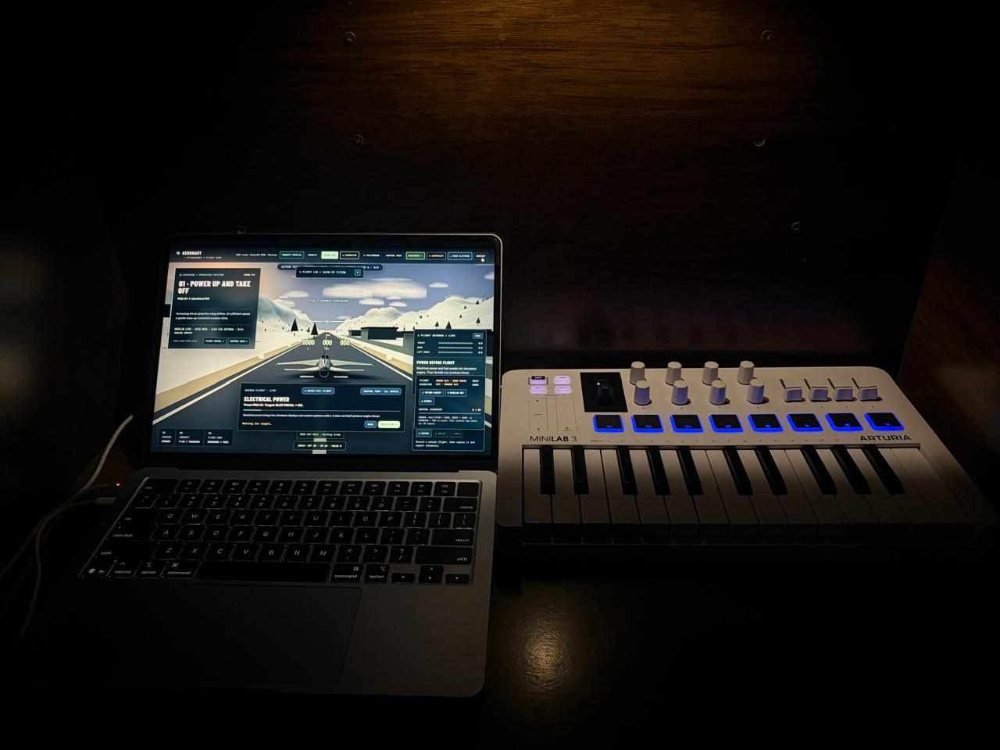

# AERONAUT

**An F-16-inspired flight experience controlled with a music keyboard.**

[**Play AERONAUT**](https://aeronaut-hazel.vercel.app) · [**Watch the demo**](assets/demo.mp4)



## Demo

[**Watch the 69-second MiniLab 3 flight demo (MP4)**](assets/demo.mp4)

The recording shows AERONAUT running on a laptop while the Arturia MiniLab 3 is used alongside it. The controller and flight screen are visible in the same shot.

## What is AERONAUT?

AERONAUT is a browser-based 3D flight project that uses the **Arturia MiniLab 3** as an unconventional flight controller. I wanted to find out how far a music-production device could be pushed outside of music: piano keys become aircraft commands, faders handle throttle and aerial maneuvers, and pads, knobs and touch controls change how you fly.

The result is an F-16-inspired flight playground with a simplified flight model, snowy mountain scenery, interactive challenges and a flight-data lab. It is an experiment in creative interfaces, not a professional aviation simulator.

## Explore the sky

- **Fly:** Take off, steer, change altitude and switch between cockpit, chase and cinematic views.
- **Operation Icefall:** Navigate the mountain environment, scan research stations and complete fictional target challenges.
- **Stunts:** Use MiniLab faders to trigger cinematic barrel roll, loop and corkscrew maneuvers.
- **Flight Lab:** Explore how changes to controls affect aircraft behavior.
- **Record and replay:** Capture flight telemetry, review a flight and export data.
- **Keep exploring:** Procedural mountain sections continue beyond the mission area.
- **No MiniLab?** Keyboard fallback controls are available for testing.

## How it works

```text
Arturia MiniLab 3
       │ USB MIDI
       ▼
Browser Web MIDI API
       │
       ▼
Control mapping → Flight state / missions
       │
       ▼
Three.js scene + HUD + telemetry recorder
```

AERONAUT runs in the browser using **JavaScript, Three.js, Vite and the Web MIDI API**. The simulated flight model is deliberately lightweight so the controller's input feels immediate and expressive.

### Controls

The full mapping is available in the in-game **Control Deck**. In the current stunt setup, Fader 1 handles throttle, while Faders 2–4 can trigger barrel roll, loop and corkscrew animations; some controls change function during mission tasks.

## Run locally

Requires a recent Node.js installation.

```bash
npm install
npm run dev
```

Open the local URL printed by Vite. For MIDI support, use a compatible desktop browser such as **Chrome or Edge** and allow access to your MiniLab 3 when prompted. The public deployment also uses HTTPS, which supports Web MIDI permission prompts in compatible browsers.

To build:

```bash
npm run build
```

## Repository layout

The published repository currently keeps the application entry point and modules at its root:

```text
AERONAUT/
├── index.html
├── main.js
├── flight.js
├── midi.js
├── mission.js
├── navigation.js
├── recorder.js
├── experiment.js
├── demo.js
├── *.css
├── package.json
├── test-*.mjs
├── assets/
│   ├── setup.jpg
│   └── demo.mp4
└── README.md
```

## Notes

This is an experimental game and interaction prototype. Flight behavior is simplified, and mission targeting and stunts are fictional or cinematic. Web MIDI device support varies by browser and platform.

**Live:** https://aeronaut-hazel.vercel.app
